# Exploratory analysis of 2024 chatgpt reviews with LinguaLoupe

## Abstract

The increasing popularity of conversational artificial intelligence has made understanding user's experiences and opinions about these technologies increasingly relevant. This project presents an exploratory data analysis of a collection of ChatGPT user reviews from 2024, with the aim of identifying the main strengths and weaknesses of the platform as perceived by its users.

The analysis was performed using LinguaLoupe, a tool that combines text and topic classification to explore collections of documents.

The results reveal that users frequently discuss the mobile application alongside the capabilities of the underlying chatbot.

Positive reviews particularly highlight ChatGPT's ability to adapt to individual needs and provide useful answers; making people feel like they are talking with a knowledgeable person rather than with a chatbot. They also focus on how the chatbot has improved their personal and professional lives by helping them with educational activities, organizing schedules and streamlining tasks.

Conversely, negative reviews frequently report authentication difficulties, technical problems such as application freezing, the interface not working properly, phones overheating, and unexpected error messages appearing. 

Other concerns are missing features, particularly those available in the web version like plugins and browsing capabilities. Some feedback also reports chatgpt having outdated knowledge, inaccurate responses and censorhip when discussing controversial subjects.

Finally, some negative reviews also include requests for improvements, mainly a version for IPads and old versions of IOS.

Overall, the findings suggest that while users appreciate ChatGPT's conversational capabilities and usefulness, technical limitations and missing functionality can negatively affect their experience. Furthermore, this project demonstrates how LinguaLoupe can facilitate the exploration of user feedback by combining topic classification and text visualizations.

## Purpose

In this day and age conversational AI has greatly influenced both daily lives and the job market by allowing users to automate tedious tasks and quickly look for information. Among the landscapes of chatbots that have come out on this past years there is one which clearly has gained more fame than the rest, OpenAi's ChatGPT.

But what do the people using it think of it?

On this project an exploratory data analysis on a collection of user reviews of ChatGPT from 2024 is performed to figure out which are the strong and weak points of this technology.

## Warning

Before proceeding it is important to highlight that the main purpose of this project is to perform an exploratory data analysis.

The conclusions derived from this study only apply to the dataset used and can not be generalized as no inferential analysis will be performed.

Finally, the dataset selected only includes reviews from up to 2024, therefore some of the negative aspects detected might have been fixed in posterior releases of chatgpt and it's app version.

## Objectives

The main goals of this analysis are:

- Explore a collection of reviews to see which are the strong and weak points of ChatGpt mentioned in this dataset.

- Perform an exploratory analysis with LinguaLoupe.

## Materials and Methods

The dataset explored consists of a collection of ChatGPT user reviews compiled by Alexandra Kim on 2024, alongside a label specifying if the review is positive or negative (https://www.kaggle.com/datasets/alexandrakim2201/chatgpt-user-reviews).

The dataset consists of 2,292 multilingual reviews: 1028 of which are positive and the other 1264 are negative. 

However, this collection of data contains some empty reviews that, since they do not provide any value for the purposes of this analysis, have been removed. Leaving a total of 868 positive reviews and 1262 negative ones.

For the scope of this analysis, only english texts will be taken into account, this will allow us to generate wordclouds without having to collect stopwords on multiple languages not understood by the author. 

In order to filter the data of interest without having to check each review one by one, a language detection model was needed and, since current approaches struggle with short texts such as some of the reviews in the datset, the following method was used:

- First, an initial screening was performed with fasttext-langdetect, a Python wrapper around Facebook's pretrained lid.176 fastText language identification model.

- Afterwards, a second filtering was performed on those text that were not classified as english with lingua-language-detector, a language detection library built with the purpose to improve language detection accuracy on short texts.

- Finally, the texts lingua-language-detector has classified as english are checked by the author and, if they in fact are in english, are included in the analysis.

Thanks to this method the scope of this analysis was reduced to 1181 negative reviews and 847 positive ones, which can be checked on the file Final_Dataset.csv provided in this repository.

For the exploratory analysis LinguaLoupe version v.0.5.2-alpha was used (https://github.com/OSCAR-CASALS/LinguaLoupe), an analysis tool that combines transformer-based text classification with BERTopic topic classification to discover what a collection of texts is about and how its authors feel about those topics. 

This tool performs two topic classifications: one based on all texts which allows for a general understanding of the data and another one that only contemplates the texts for each sentiment.

The results are shown in an html report containing a variety of plots some of which will be explained at the next section, and csv files displaying information for each topic that allows to understand them, like their most representative texts and most relevant words. 

The html report is divided in multiple sections:
- Summary: Shows a general overview of the data and vizualizations of the topic classification performed on all texts independently of sentiment.

- An individual section for each label (positive and negative in this case) showing different plots related to the texts belonging to the appropiate sentiment and the appropiate topic classification.

All of LinguaLoupe output files can be found in this repository.

Since the sentiment of each review has already been defined in the dataset, for this anlysis only topic classification was required, to perform it the following parameters had to be defined:

- The embedding model that BERTopic will use to convert each review into numeric vectors.
- The minimum number of documents required to form a distinct topic.

The embedding model selected was all-mpnet-base-v2 (https://huggingface.co/sentence-transformers/all-mpnet-base-v2) due to the fact that the documentation indicates that it was designed for encoding sentences and short paragraphs, which corresponds to the length of most of the reviews in the dataset, and it's more accurate than the default option of LinguaLoupe and BERTopic: all-MiniLM-L6-v2.

The main disadvantage of this choice is that all-mpnet-base-v2 is much slower than all-MiniLM-L6-v2, but since in this case we are dealing with a relatively small amount of texts the sacrifice in speed is acceptable.

For the minimum number of documents required to form a distinct topic, from now on refferred as minimum topic size, an amount of 20 was set for the global topic classification, and one of 15 for the topic classification of each senitment.

Having a bigger minimum topic size for the global analysis allows us to first understand the major points of discussion regarding chatGPT, independently of the sentiment of the reviews, before doing a more in-depth analysis of each sentiment.

The LinguaLoupe command used for this analysis looks as follow:

```
python LinguaLoupe.py -ti 'CHATGPT User Reviews' -dt test_datasets/Final_Dataset.csv -text_c Review -o results -lang english -col label -colors colors/chatgpr_user_reviews_colors.json -min_topic_size 15 -min_topic_size_global 20 -e_model sentence-transformers/all-mpnet-base-v2
```

## Results

In this chapter the most important plots produced by LinguaLoupe will be analyzed alongside each topic.

To start off the overview section of the html report will be studied in order to have a general idea of what the reviews in the dataset are talking about, then a more in-depth look will be given to positive and negative reviews using their appropiate sections.

Figure 1 shows the review length of positive and negative reviews, displaying similar word counts for both positive and negative ones. 

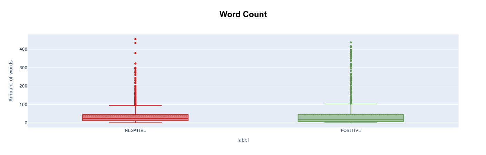

_Figure 1: Word count of positive and negative reviews_

Most texts posses a length below 100. However, there are some clear outliers in both positive and negative reviews that surpass this amount of words.

Zooming in on negative reviews reveals that their length is quite variable, with a median of 24, a mean of 38.41, an Inter Quartile Range (IQR) of 33; and the lower and upper whisker situated at 1 and 94 respectively.

For positive reviews a similar behaviour is observed with a median of 18, a mean of 46.94, an Inter Quartile Range (IQR) of 33; and the lower and upper whisker situated at 1 and 94 respectively.

Figure 2 shows how this zoom in looks like.

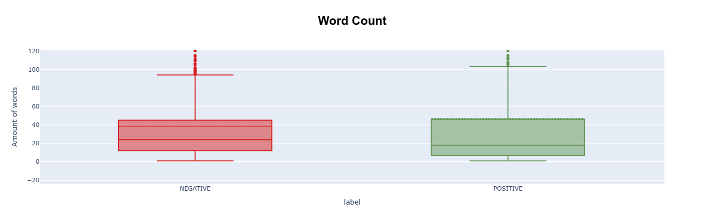

_Figure 2: Observation of both NEGATIVE and POSITIVE reviews length without taking into account outliyers._

LinguaLoupe also generated a UMAP across all reviews as seen in figure 3, it shows that most positive and negative texts are quite similar without a clear line of separation between them, additionally, at the upper right of the visualization there is a small cluster of reviews which seem to differ a lot from the others.

An indepth look onto them reveals that these correspond to extremly short reviews which sometimes do not provide a lot of infrmation, like: "pichi peaks", "mega fail!!!" or "1of1"; or really long reviews talking about the use of chatgpt on the profesional or personal live of the reviewer, indicating it's strong suits or some problems they have had with it.

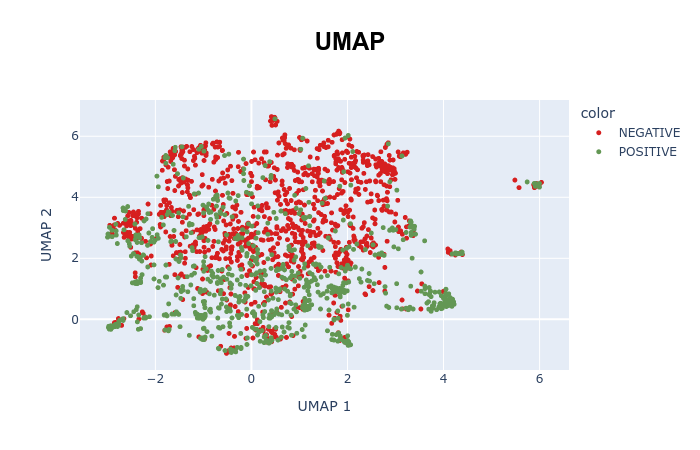

_Figure 3: UMAP of reviews. Negative reviews are coloured in red while positive ones in green._ 

Figure 4 shows the most frequent words across all reviews, it suggests that the app version of chatgpt is the major topics of discussion in the dataset.

Other words quite noticeable in the plot are "ipad" and "phone", which suggests some users talked about their experience using the chatbot from a mobile device.

The word "use" is also quite big which implies that there is a big amount of reviews talking about the usability of chatgpt and the app, by the looks of the plot they will probably mention the app's features, the conversation users have with the ai, and the responses they receive.

It is also important that version is also quite noticeable which implies could be talking about different versions from chatgpt, which at the time of the dataset reached until GPT-4.

Finally, the word "work" is quite big suggesting some users talk about how they use the chatbot in their profesional environment.

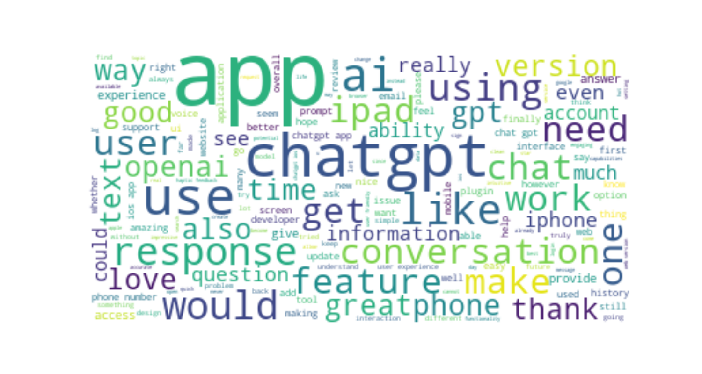

_Figure 4: Wordcloud of all reviews. The bigger the word the most frequent it is._ 

As seen in figure 5, the first topic classification performed, which includes all reviews indepndently of their sentiment, detected 24 topics, being topic 0 by far the most frequent one, followed by 1 and 2.

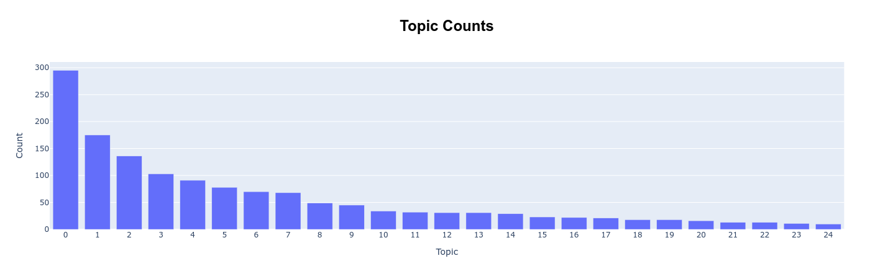

_Figure 5: Barplot displaying how many times a topic appears._

The reviews from topic 0 mostly talk about the ability of the chatbot to adapt to each user based on their conversations, the usefulness of the answers provided by the AI, it's capacity to understand context, it's base of knowledge, the balance between privacy and functionality, and the ease of use of the app's interface. Most reviews belonging to this topic are positive and the most representative ones mention that using ChatGPT feels like having a conversation with a really knowledgeable person.

Topic 1 on the other hand includes mostly negative reviews were the user was not able to sign in into their accounts, mostly due to the fact that he's phone number was not accepted. Some reviewers also mention that they did not want to provide their phone number to openai as they consider it a breach of privacy, asking for other methods of authentification.

Topic 2 mostly includes reviews where users are asking for an ipad version.

The Intertopic distance map between topics in _Figure 6_ shows that topics can be divided in three clusters: one at the bottom left, another at the top right and one at the top left.

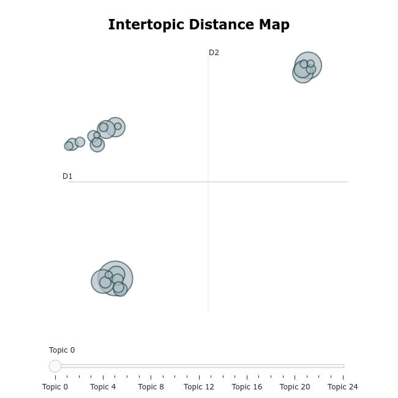

_Figure 6: Intertopic distance map of the topics detected for all reviews_

The first cluster at the bottom left of the plot consists of topics: 0, 12, 6, 22, 2, 11, 14 and 9. These talk about chatgpt's app interface, the features currently avalaible and posible new ones (like voice output or being able to lower the typing sounds), some topics include issues users have had with the app.

It is important to highlight that some of the topics in this cluster report grave issues that have negatively affected the apps image, like it's interface not working properly on ipad or paid customers complaining that the app only allows them to use gpt-3 instead of 4. Regarding this last issue some users complain that they have found out about the inability to use gpt-4 not through the app, but by asking the ai itself which version they were using.

The second cluster at the top right contains topics 1, 3, 7, 20, 21 and 17. These topics include reviews where the users have found a major problem in the app that it has not allowed them to use it, particularly, these are the most mentioned:

- App not accepting a user's phone number.
- Phones overheating when using the app.
- ChatGPT freezing while generating a response.
- The app does not work in some countries, such as Iran.
- Error "The request is invalid" appearing 

The third cluster is at the top left and consists of topics 23, 4, 5, 19, 24, 13, 16, 8, 15, 10 and 18; it can be observed in Figure 6 that it's size is not as big as the other two groups and, furthermore, the cluster looks more disperse suggesting that topics may not be as similar between them as in the other two groups, it can be divided in the following sections:

- The first section invloves topics 23 and 4 which include really short reviews that do not provide much information like "good". "thank you" or "looks nice!" as well as internet slang like "First" or "1of1"

- The second one includes topics 5 and 19, which include reviews were the user is simply happy an official app for chatgpt exists or they talk about the suscription price.

- The third section involves topics 24 and 13, these involve people really happy with the app saying it is better than other alternatives, sometimes saying that although they have a few nitpicks they'd give it 5 stars; and users talking about  the Haptic feedback, mostly in a positive way. 

- The fourth section includes topics 16 and 8, the first one includes reviews where people say they prefer the web version over the app, while the other topic involves people demanding for plugings to be added to the app as they are already avalaible in the web version of chatgpt.

- Topic 15 is a bit separated from the other sections of this cluster and includes reviews where the user has employed chatgpt to write a story.

- Finally, the last section includes topics 10 and 18 that talk about ChatGPT's knowledge base. Topic 10 includes reviews where the user mentions chatgpt censors controverisal ideas and people talking about the potential of this technology; while texts in topic 18 talk about the fact that the knowledge base of chatgpt has not been updated since September 2021, three years prior to when this reviews where collected.

### Negative reviews

When it comes to negative reviews figure 7 shows that the main topic of discussion is the app. Other important frequent words are "ipad", which as seen before some users report the app's interface does not work properly in this platform, and "use" which suggests reviewers have found issues while using the app or have found impediments that did not allow them to employ it.

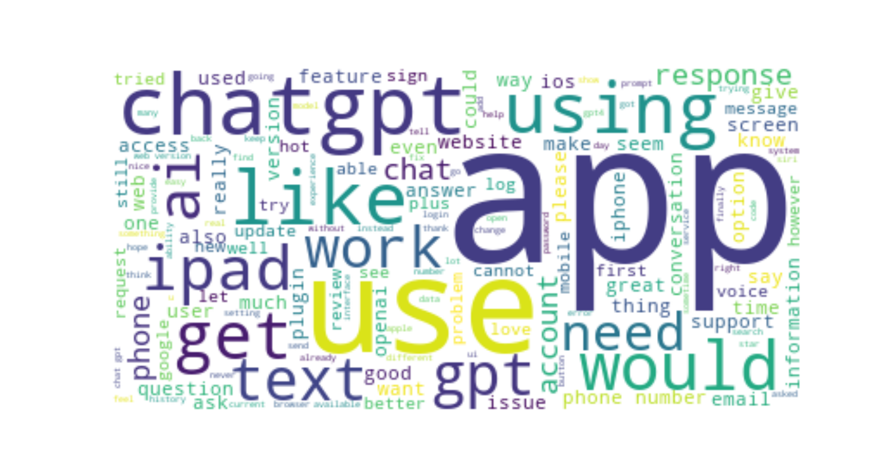

_Figure 7: Wordcloud of negative reviews. The bigger the word the most frequent it is._

Figure 8, which shows the top 10 trigrams in negative reviews, also supports that the app version of ChatGPT is the main topic of discussion, additionally, it also shows that the combination of words "my phone number" and "the web version" are quite common, as seen in the overview there are people who could not sign in due to their phone number not being accepted by the app and users who prefered the web version of chatgpt over it; this plot suggests most of the people who wrote those reviews has had a negative impresion of the software. 

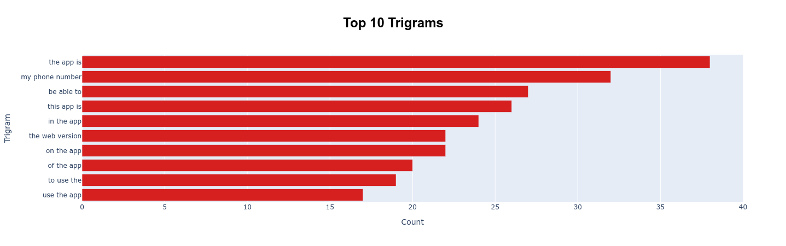

_Figure 8: Top 10 most frequent Trigrams in negative reviews._

Checking the amount of negative reviews in each global topic in figure 9 it can be observed that topic 1 is the most frequent one, which means most negative reviews come from people who could not log in due to their phone number not being accepted.

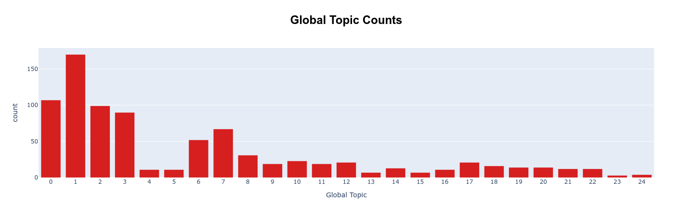

_Figure 9: Barplot displaying how many negative reviews each global topic has._ 

From this point forward topic numbers will refer to the topics detcetd by the topic classification of only negative texts unless specified otherwise.

As seen in figure 10 the topic classification of only negative reviews detected 20 topics, being topics 0, 1, 2, 3 and 4 the most frequent ones.

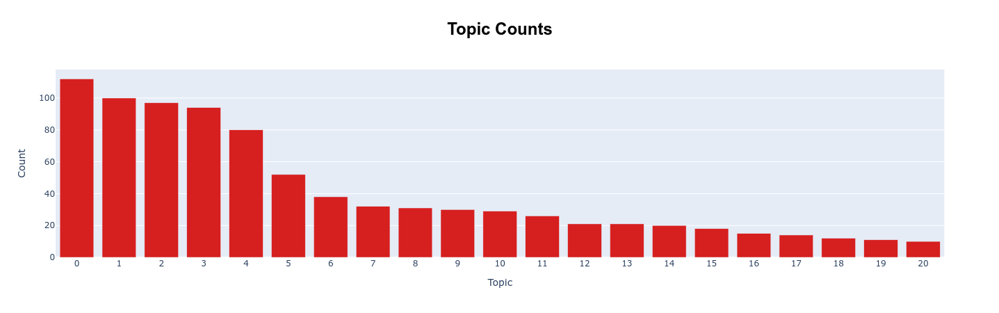

_Figure 10: Barplot displaying how many times a topic appears in a topic classification of only negative reviews._

Topic 0, the most frequent one, includes reviews were the users have felt the app needed some new features, whether it'd be a better designed interface that works on ipads, support for pluggings, runnable code cells like the ones that can be found on notebooks, a prompt library so users can save their prompt templates... Some of the users mention that the browser version of chatgpt has more features than the app and list some of the things they would like to be brought in.

Topic 1 on the other hand includes reviews were the user could not create or access an account.

The main reason provided is that their phone number was not accepted often stating they'd prefer other methods of authentification like mail or apple account. Another prominent reason given across the reviews is the direct refusal to create an account due to the the amount of information required being considered excessive and a breach of privacy, particularly the phone number.

Other reviews in this topic specify that the user has had an error message pop up whcih prevented them to create the account or access it, while other reviewers also complain they could not get past the verification catchas eventhough they are completing them correctly. 

The reviewers from this group that had an account but could not access it due to any of the previous reasons sometimes express worry that an external company now possesses their data in exchange for a service they can not use, without having any way to end their registrations.

Topic 2 includes reviews that complain the app freezes often.

Topic 3 reviews state that the reviewers phones started overheating after they opened the app.

Topic 4 consists of reviews asking for an ipad version of the app.

Regarding the similarities between topics, the Intertopic Distance Map in figure 11 shows that all topics can be divided in 5 clusters.

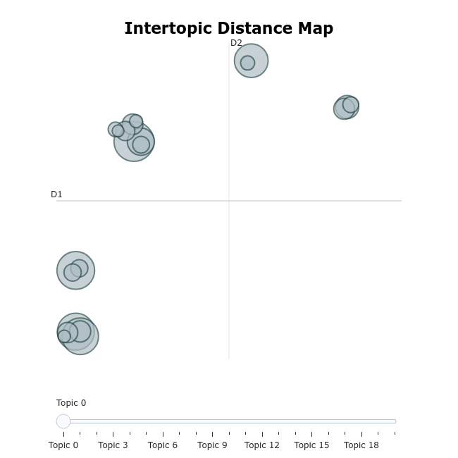

_Figure 11: Intertopic distance map of the topics detected for only negative reviews._

The first cluster at the bottom left consists of topics 3, 7, 2, 10 and 19; which talk about technical errors the users have encountered while using the app, like phones overheating, chatgpt freezing, error "request is invalid" appearing, and users being unable to login because of error messages or due to their keyboard disappearing.

The only odd one out of this cluster would be 7 which includes reviews were users ask for plugins and browsing, features already present in the web version of chatgpt but not in the app. A reason why this topic is so close to the others could in the plot could be that some users thought the lack of plugins and browsing was due to an error instead of them not being present in the app, as reflected by the following reviews: 

- "i'm ok with this app but i don't know why i can't use the browser function in this version? anybody else has this problem?"

- "great but my web browsing / plugins aren't working on the app currently"

- "i have access to plug - in's and web access but it doesn't let me use it on the app? is this just a feature that hasn't been added yet or am i missing something?"

The next cluster, situated on top of the previous one, is composed of topics 1, 12 and 13. These three talk about reasons the users have not been able to use the app, the main ones are the following:

- The phone number required for creating an account is not accepted or the user prefers to not register for a plan that asks this information in the firs place, as they consider it a breach of privacy.

- App not working on certain countries.

- The UI for introducing the birthdate of a user when creating an account is badly designed, only allowing to move between months one at a time and causing users to accidentally introduce the current date as their birthday without giving them any way of rectifiying it once the account is made, locking the reviewer out of the account for being underage in the eyes of the software.

At the top left of this cluster the next one is present, composed of topics 0, 5, 14, 18, 9, 11, 20 and 16.

Set topics focus on reviews where the user complains the features present in the app do not work as expected, or feels the app lacks important features that would really improve it's usability to the point some consider the paid plan is not worth paying. These are the main focuses:

- Chatgpt 4 not being avalaible eventhough many reviewers expected it.
- Password feature not working properly.
- Copy and paste feature not being intuitive to use and some saying it should not default to selecting all the response to a prompt when copying but, instead, just the part the user is interested in.
- Voice support not being what users expected and lacking features they think it should have, like being able to speek queries with the app auto-detecing when the user has finished speaking.
- Chat history being hard to navigate or not being well positiones in the interface of the app.

At the to the top right of the plot two clusters can be found, the one at the top of the visualization is composed of topics 4 and 17. The first topic includes reviews asking for an ipad version of the app while the second one for a version that works on old versions of IOS, like 15.

The final cluster, located at the top right, is composed of topics 15, 6 and 8.

Topics 15 and 6 talk about chatgpt's answers, the first one includes users complaining the knowledge base of the chatbot was last updated on September 21 causing some answers to be outdated, while topic 6 includes reviews where the user reports that Chatgpt answers are not correct, what is commonly refered as hallucinations, while others also add that some controversial topics are censored by the chatbot.

Topic 8 on the other hand includes a variety of reviews talking about a mix of things that have been seen so far all mentioning openai.

### Positive reviews

Based on the most frequent words shown in figure 12 most positive reviews focus on Chatgpt istelf and it's app version. Other frequent words like "conversation" and "response" seem to suggest reviewers are happy with the replies they receive from the chatbot. The words "use", "experience" and "feature" seem to indicate that unlike negative reviewers positive ones have had an easier time using the app and it's different features.

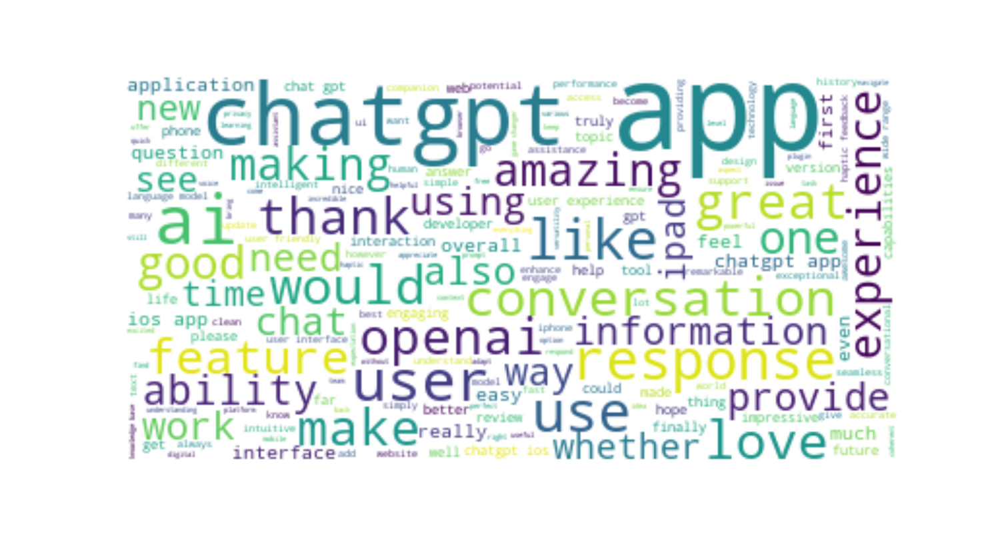

_Figure 12:  Wordcloud of positive reviews. The bigger the word the most frequent it is._

The most frequent trigrams shown in figure 13 support the fact the app is the most common topic of discussion on this dataset, some specifying they are talking about the ios version of it.

Other trigrams also suggest that users have a good impresion of the abilities of chatgpt and the haptic feedback.

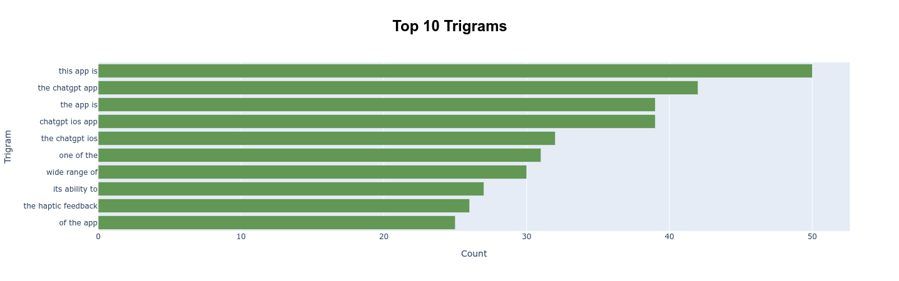

_Figure 13: Top 10 most frequent Trigrams in positive reviews._

Figure 14 shows the frequency of each global topic shown in the overview section across positive reviews. From it we can see that global topic 0 is by far the most frequent one which suggest most positive reviews talk about the adaptability of chatgpt to each user, the usefulness of it's answers, it's capacity to understand context, it's knowledge base, the balance between privacy and functionalyt, and the ease of use of the interface.  

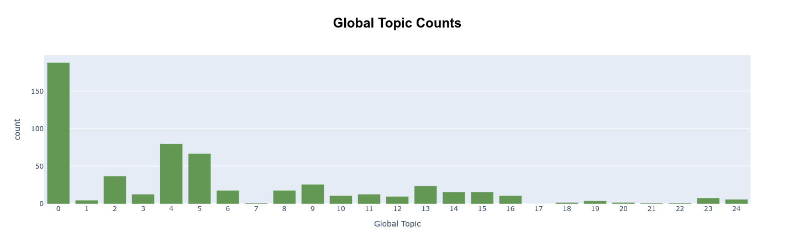

_Figure 14: Most frequent global topics in positive reviews._

From this point forward topic numbers will refer to the topics detcetd by the topic classification of only positive texts unless specified otherwise.

As seen in fugure 14 the topic classification of only positive reviews has detected 9 topics, from which 0 and 1 are the most frequent ones.

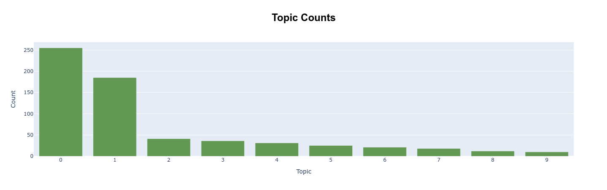

_Figure 15: Barplot displaying how many times a topic appears in a topic classification of only positive texts._

Positive topic 0 includes reviews from users that are satisfied with both chatgpt and it's app version, highlighting it's easy to use interface, the chatbot's capacity to adapt to each user, and openai's data security. Some reviewers say chatgpt feels more like talking to a knowledgeable friend rather than to a chatbot.

Topic 1 on the other hand includes reviews where users mention that chatgpt has completely transformed their lives, using it to help with schoolwork, organizing schedules, and streamlining tasks.

The intertopic distance map shown in figure 16 displays two clusters and a single topic separated from the rest.

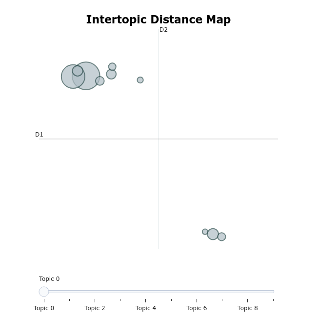

_Figure 16: Intertopic distance map of the topics detected for only positive reviews._

The cluster at the lower right is composed of topics 6, 2 and 9; the first two topics include simple positive reviews, consisting of one or two wrods, like "great" or "very good". Topic 9 consists of 10 reviews stating that the reviewer is excited for the release of the official chatgpt app.

On the other hand, the cluster at the top left is composed of topics 0, 1, 3 ,7, 4 and 5.

Most positive reviews are included in this cluster:

- Topics 0 and 1 are specially close due to their similarity as they include reviews were people are extremly satisfied with some reviewers saying chatgpt has changed their personal and profesional lives.

- Topic 3 also includes people who are satisifed with the app but lamment the fact there is not an ipad version avalaible.

- Topic 5 includes reviews that talk about the haptic feedback.

- Topic 4 includes reviews that exprese satisfaction with the app and mention openai.

- Topic 7 include reviews of users that like the app but would like plugins to be implemented.


Finally, separated from the previous two clusters, there is topic 8 which includes positive reviews where the users indicate that their phone gets hot quickly when using the app.


## Conclusion

The analysis performed shows that most users focus on chatgpt's app reather than in the chatbot itself. This suggests that the overall user experience is not only influenced by the quality of the AI but also by the software surrounding it.

Negative reviews reveal several recurring problems. Authentication difficulties are particularly prominent, with many users reporting that they cannot create or access their accounts, mostly due to phone number verification issues. 

Other reasons the users have not been able to use the app are the dificult to navigate birthday calendar UI, the app not being avalaible in certain countries, the interface suddenly not working properly, and the user not wanting to provide sensitive information to openai.

Other frequently mentioned problems in negative reviews include application freezing, phones overheating and unexpected errors. Additionally, some users express dissatisfaction with the lack of features available in the mobile application compared to the web version, particularly plugins and browsing capabilities.

The analysis also reveals several requests for improvements, including IPad and old IOS versions support, enhanced voice interaction, the ability to use GPT-4 in the app, and to improve the copy and paste feature.

Regarding the chatbot itself, some reviewers criticize its outdated knowledge base, inaccurate responses and restrictions when discussing sensitive or controversial subjects.

On the other hand positive reviews are much more similar between them. Users particularly appreciate ChatGPT's ability to understand context, adapt to individual needs and provide useful answers; this has made some reviewers feel like they are talking with a knowledgeable person rather than with a chatbot when using Chatgpt. Several reviewers also highlight how the chatbot has improved their personal and professional lives by helping them with educational activities, organizing schedules and streamlining tasks.

Finally, this project demonstrates how LinguaLoupe can be used to perform exploratory analyses of collections of user reviews. By combining word-frequency visualizations, topic modelling and representative documents, the tool provides an overview of the subjects discussed in a dataset and facilitates the identification of recurring opinions, problems and suggestions for improvement.
